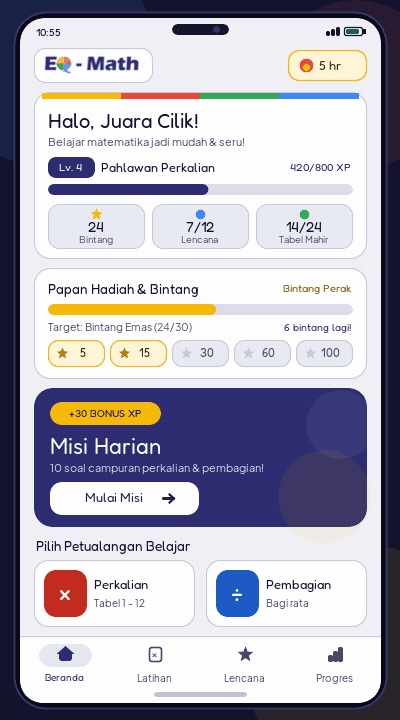
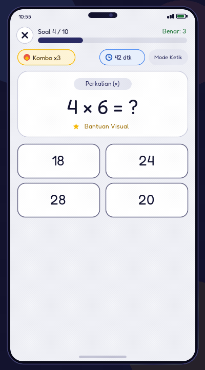
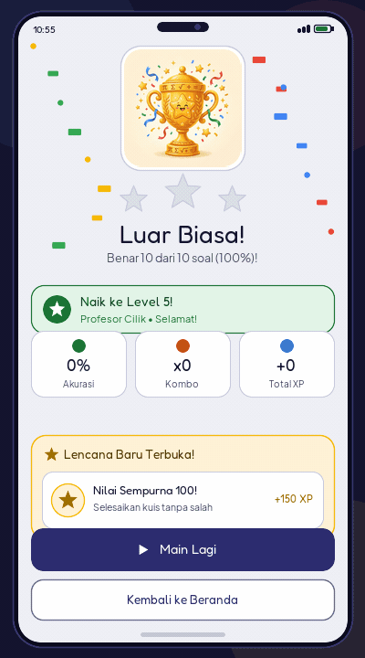
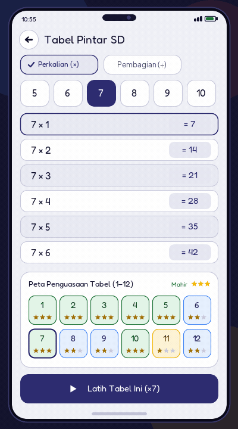

<div align="center">


### **Belajar Jadi Mudah!**

*Interactive Indonesian elementary school (SD) multiplication & division math quiz game built with Kotlin, Jetpack Compose, Material Design 3, and Firebase.*

<p>
  
  
  
  
  
  
</p>

<p>
  <a href="#-gameplay-showcase-22"><strong>Gameplay Showcase</strong></a> ·
  <a href="#-key-features"><strong>Features</strong></a> ·
  <a href="#-gamification-system"><strong>Gamification</strong></a> ·
  <a href="#-architecture--tech-stack"><strong>Architecture</strong></a> ·
  <a href="#-getting-started"><strong>Getting Started</strong></a> ·
  <a href="#-cicd--github-pages"><strong>CI/CD &amp; Pages</strong></a>
</p>

</div>

---

## Overview

**EQ-Math** helps Indonesian elementary school students (*Sekolah Dasar / SD*) master multiplication (`×`) and division (`÷`) tables from **1 to 12** through bite-sized quizzes, visual dot-group hints (*Bantuan Visual*), daily missions, streaks, star milestones, and collectible achievement badges.

Designed around the **EQ-Math 4-Quadrant Brain Color System** (Navy `#2D2C70`, Yellow `#F6B908`, Red `#E94639`, Green `#35A853`, Blue `#4285F4`) with strict **WCAG 2.1 AA/AAA contrast** in both Light and Dark themes, TalkBack live-region announcements, and adaptive phone/tablet layouts (`NavigationBar` + `NavigationRail`).

---

## Gameplay Showcase (2×2)

High-frame-rate animated walkthroughs of EQ-Math's four core learning experiences (60Hz timeline physics, browser-safe smooth constant-rate GIFs):

<table>
  <tr>
    <td align="center" width="50%">
      <br />
      <strong>1. Beranda &amp; Papan Hadiah</strong><br />
      <sub>Live XP level progress, streak badge, Star Milestones &amp; <em>Misi Harian</em> (+30 Bonus XP)</sub>
    </td>
    <td align="center" width="50%">
      <br />
      <strong>2. Kuis Interaktif &amp; Bantuan Visual</strong><br />
      <sub>Animated dot-group visual hints, live combo counter, countdown timer &amp; instant feedback</sub>
    </td>
  </tr>
  <tr>
    <td align="center" width="50%">
      <br />
      <strong>3. Hasil Kuis, Bintang &amp; Lencana</strong><br />
      <sub>Trophy celebration, spring-animated 3-star rating, level-up banner &amp; badge unlocks</sub>
    </td>
    <td align="center" width="50%">
      <br />
      <strong>4. Tabel Pintar SD &amp; Peta Penguasaan</strong><br />
      <sub>Interactive 1–12 multiplication/division guide with per-table 3-star mastery map</sub>
    </td>
  </tr>
</table>

> Want to regenerate or tweak the showcase GIFs? Run `python3 scripts/generate_showcase_gifs.py`.

---

## Key Features

- **Four Adventure Modes**
  - **Latihan Perkalian (`×`)**: Practice tables `1–12` or mixed random questions.
  - **Latihan Pembagian (`÷`)**: Clean whole-number division drills built for young learners.
  - **Tantangan Campuran (`×÷`)**: Fast mixed multiplication & division challenges.
  - **Misi Harian**: Daily 10-question mixed mission granting `+30 BONUS XP` and extending daily streaks.
- **Visual Math Hints (*Bantuan Visual*)**: Interactive grouped-dot diagrams that visually explain *why* `4 × 6 = 24` or how equal division groups work.
- **Dual Input Modes & Pacing**: Switch seamlessly mid-quiz between **2×2 Multiple Choice** (*Pilihan Ganda*) and **Numeric Keypad** (*Ketik Angka*), in either **Santai** (relaxed) or **Kilat Waktu** (timed bonus XP) mode.
- **Smart Table Guide (*Tabel Pintar SD*) & Mastery Map**: Browse clean `1–12` tables with one-tap *"Latih Tabel Ini"* launch and track 3-star mastery across all 24 multiplication/division tables.
- **Cloud Sync + Instant Guest Mode**:
  - **Google Sign-In** via Jetpack `CredentialManager` + Firebase Authentication & Cloud Firestore (`MathProgressRepository`) with per-user zero-trust security rules (`firestore.rules`).
  - **Mode Tamu** (`LocalGuestMathRepository`) for immediate offline trial without creating an account.
- **Inclusive & Adaptive Design**:
  - WCAG 2.1 AA/AAA color contrast tokens across Light & Dark modes (`Color.kt`).
  - Minimum `48dp` interactive touch targets, semantic headings, TalkBack `LiveRegionMode` announcements, and adaptive `NavigationRail` on tablets/foldables (`>= 600dp`).

---

## Gamification System

| Progression Pillar | Tiers / Milestones |
| :--- | :--- |
| **8 Learner Levels** | `Lv.1 Pemula Ceria` → `Lv.2 Penjelajah Angka` → `Lv.3 Bintang Hitung` → `Lv.4 Pahlawan Perkalian` → `Lv.5 Profesor Cilik` → `Lv.6 Kapten Pembagian` → `Lv.7 Master Matematika` → `Lv.8 Legenda EQ-Math` |
| **5 Star Milestones** | `Bintang Perunggu` (5★) · `Bintang Perak` (15★) · `Bintang Emas` (30★) · `Bintang Berlian` (60★) · `Mahkota Galaksi` (100★) |
| **12 Unlockable Badges** | *Langkah Pertama*, *Jagoan Perkalian*, *Master Pembagian*, *Nilai Sempurna 100!*, *Kombo Kilat*, *Semangat 3 Hari*, *Kolektor Bintang*, *Pejuang 100 Soal*, *Penakluk 5 Tabel*, *Si Cepat Tangkas*, *Anak Rajin*, *Profesor Cilik* |
| **XP Formula** | `10 XP/correct` + `3 XP × maxCombo` + `35 XP` (100% perfect bonus) + `20–30 XP` (Timed/Daily mode) + badge bonus XP |

---

## Architecture & Tech Stack

EQ-Math follows **Clean MVVM** with unidirectional state flow (`StateFlow` + `collectAsStateWithLifecycle`) and a swappable `MathRepository` abstraction supporting both Firebase Firestore and offline Guest sessions.

```text
UI Layer (Jetpack Compose M3 + Adaptive Navigation)
   │  HomeScreen · PracticeHubScreen · QuizScreen · QuizResultScreen
   │  AchievementsScreen · ProgressScreen · TableGuideScreen · AuthScreen
   ▼
Presentation Layer (MathAppViewModel + StateFlow)
   │  DashboardUiState · ActiveQuizState · QuizResultState · PracticeConfig
   ▼
Domain Layer (Pure Kotlin Logic)
   │  QuizGenerator · GamificationEngine · RewardManager
   ▼
Data Layer (MathRepository Interface)
   ├── MathProgressRepository  ──► Firebase Firestore & Auth (Google CredentialManager)
   └── LocalGuestMathRepository ──► In-memory offline Guest Mode
```

### Core Technologies

| Category | Stack |
| :--- | :--- |
| **Language & Build** | Kotlin `2.4.21`, AGP `9.1.1`, Gradle `9.3.1`, Version Catalog (`libs.versions.toml`) |
| **UI & Design** | Jetpack Compose BOM, Material Design 3, Custom Bundled Fonts (`Fredoka`, `Plus Jakarta Sans`, `Nunito`, `Poppins`) |
| **Backend & Auth** | Firebase BOM `35.1.0`, Cloud Firestore, Firebase Auth, Jetpack `CredentialManager` (`googleid`) |
| **Testing** | JUnit 4, Kotlin Coroutines Test, Robolectric `4.16.1`, Compose UI Test, Firestore Security Rules Suite (`firestore.test.js`) |

---

## Project Structure

```text
EQ-Math/
├── .github/
│   ├── ISSUE_TEMPLATE/          # Bug report & feature request YAML forms
│   ├── workflows/               # Android CI, Release APK, GitHub Pages, Repo Metadata Sync
│   ├── PULL_REQUEST_TEMPLATE.md
│   ├── dependabot.yml           # Weekly Gradle & GitHub Actions dependency updates
│   └── repo-metadata.json       # Canonical GitHub description & 20 topics/tags
├── app/
│   └── src/
│       ├── main/java/com/example/
│       │   ├── auth/            # GoogleAuthHelper (Jetpack CredentialManager)
│       │   ├── data/            # MathModels, MathProgressRepository, LocalGuestMathRepository
│       │   ├── domain/          # QuizGenerator, GamificationEngine, RewardManager
│       │   └── ui/              # MathAppViewModel, screens/, components/, theme/
│       └── test/java/com/example/
│           ├── RewardManagerTest.kt
│           ├── ExampleRobolectricTest.kt
│           └── ExampleUnitTest.kt
├── docs/                        # GitHub Pages interactive showcase site + 2x2 GIF assets
├── scripts/
│   ├── generate_showcase_gifs.py
│   └── setup-github-repo.sh     # One-command GitHub description, topics, Pages & tag setup
├── firestore.rules              # Zero-trust per-user Firestore security rules
├── firestore.test.js            # Automated Firestore rules test suite
└── firebase-blueprint.json      # Firestore schema & collection blueprint
```

---

## Getting Started

### Prerequisites

- **JDK 17** (Temurin recommended)
- **Android SDK** (`compileSdk 36`, `minSdk 24`)
- **Gradle 9.3.1** (or Android Studio Meerkat / Narwhal+)

### Local Setup & Commands

1. **Clone the repository**
   ```bash
   git clone https://github.com/<owner>/EQ-Math.git
   cd EQ-Math
   ```

2. **Prepare signing keystore & environment file**
   ```bash
   base64 --decode debug.keystore.base64 > debug.keystore
   cp .env.example .env
   ```

3. **Run unit & Robolectric tests**
   ```bash
   gradle :app:testDebugUnitTest
   ```

4. **Run Android Lint & build Debug APK**
   ```bash
   gradle :app:lintDebug
   gradle :app:assembleDebug
   ```
   The compiled APK will be generated at `app/build/outputs/apk/debug/app-debug.apk`.

---

## CI/CD & GitHub Pages

This repository ships with four automated GitHub Actions workflows:

| Workflow | Trigger | What It Does |
| :--- | :--- | :--- |
| **`Android CI`** (`.github/workflows/android-ci.yml`) | Push / PR to `main` | Decodes debug keystore, runs JUnit & Robolectric tests, runs Android Lint, builds Debug APK, validates Firebase JSON/rules, and uploads artifacts. |
| **`Release Android APK`** (`.github/workflows/release.yml`) | Tag `v*.*.*` or manual | Runs unit tests, builds Debug APK (plus signed Release APK/AAB when `KEYSTORE_BASE64`, `STORE_PASSWORD`, and `KEY_PASSWORD` secrets are set), generates `SHA256SUMS.txt`, and publishes a GitHub Release. |
| **`Deploy GitHub Pages`** (`.github/workflows/pages.yml`) | Push to `docs/**` | Publishes the `docs/` showcase website (with live interactive mini-quiz & 2×2 GIF gallery) to GitHub Pages. |
| **`Sync Repository Metadata`** (`.github/workflows/repo-metadata.yml`) | Push to `.github/repo-metadata.json` or manual | Syncs GitHub About description, homepage URL, and 20 topics/tags. |

### Apply GitHub Description, Tags & Release Tag

After pushing this repository to GitHub, run the setup helper once with the [GitHub CLI](https://cli.github.com/):

```bash
chmod +x scripts/setup-github-repo.sh
./scripts/setup-github-repo.sh
git push origin v1.0.0
```

> **Canonical Description:** `EQ-Math — Belajar Jadi Mudah! Gamified Android multiplication & division quiz app for Indonesian elementary students (SD), built with Kotlin, Jetpack Compose, Material 3, and Firebase.`
>
> **Topics / Tags:** `android`, `kotlin`, `jetpack-compose`, `material-design-3`, `math-game`, `education`, `edtech`, `indonesia`, `elementary-math`, `multiplication`, `division`, `gamification`, `firebase`, `firestore`, `credential-manager`, `mvvm`, `robolectric`, `wcag`, `android-app`, `eq-math`

---

## Contributing & Community

- Read our [Contributing Guide](CONTRIBUTING.md) and [Code of Conduct](CODE_OF_CONDUCT.md)
- Check the [Changelog](CHANGELOG.md) for release history
- Report vulnerabilities privately via [Security Policy](SECURITY.md)

---

## License

Distributed under the **MIT License**. See [`LICENSE`](LICENSE) for full terms.
